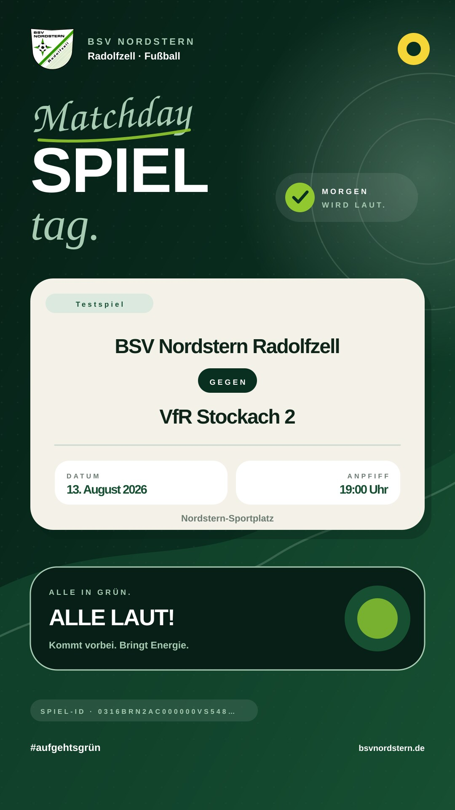
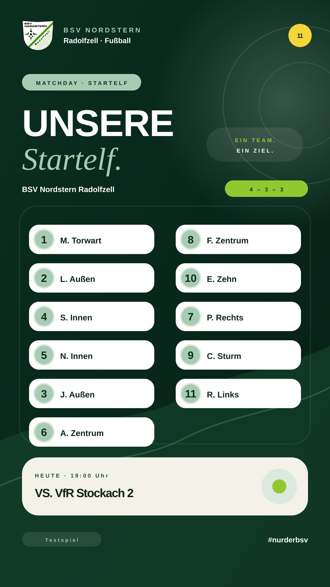
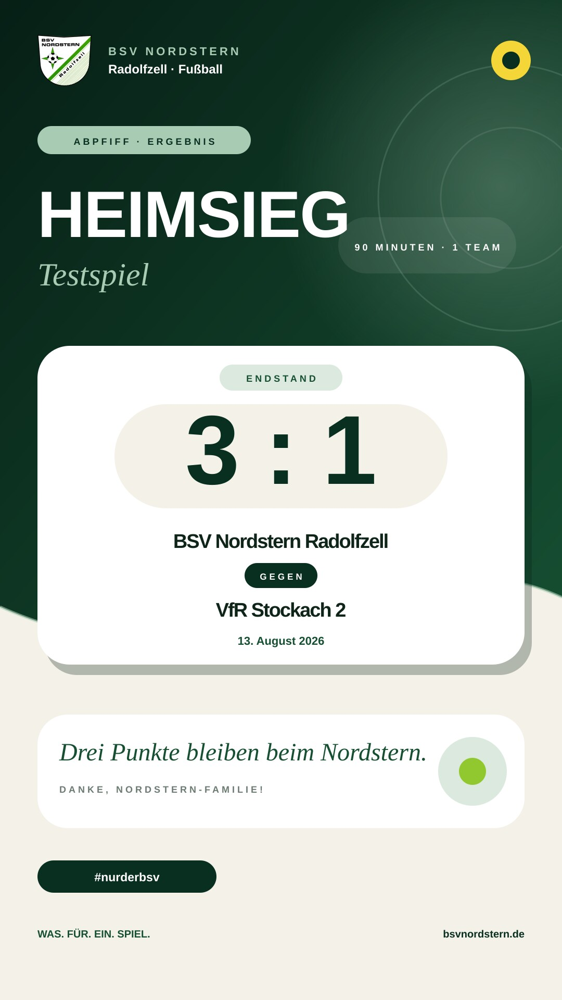

# Social Media & Club Suite

Vereinssuite für Social Media, Sponsoring und Administration des BSV Nordstern Radolfzell.

Der aktuelle Stand liefert:

- ein aus der Website abgeleitetes Corporate Design,
- editierbare Story-Vorlagen in 1080 × 1920 Pixel, einschließlich eines Geburtstagsmotivs und freier Termin-Storys,
- einen lokalen und einen online betriebenen Renderer für Spielankündigung, Aufstellung, Ergebnis und Geburtstag,
- Beispieldaten für die fussball.de-Spiel-ID `0316BRN2AC000000VS5489BTVU7GTVLE`,
- eine aktive Supabase-Struktur mit Datenbank, privatem Storage, Edge Functions und Fünf-Minuten-Cron,
- eine [private Admin-Oberfläche](https://bsv-story-automatik.jerome-ernsberger.chatgpt.site) für Spiele, freie Posts, geplante Stories und Geburtstage,
- einen zentralen, standardmäßig aktiven Testmodus.

## Vorschau

| Spielankündigung | Aufstellung | Ergebnis |
| --- | --- | --- |
|  |  |  |

| Geburtstag |
| --- |
|  |

Das vollständige Gestaltungssystem ist als [Corporate-Design-Dokument](docs/corporate-design.md) und als [visuelle HTML-Fassung](docs/corporate-design.html) enthalten.

## Schnellstart

Voraussetzung sind Node.js 22 oder neuer und ImageMagick (`magick`).

```bash
npm run check
npm run render:all
```

Die erzeugten Dateien landen in `output/`. Bereits freigegebene Beispiele liegen unter `previews/`.

Ein einzelnes Motiv lässt sich so erzeugen:

```bash
npm run render -- --type announcement --input examples/match.json
npm run render -- --type lineup --input examples/match.json --lineup examples/lineup.json
npm run render -- --type result --input examples/match.json
npm run render -- --type birthday --input examples/birthday.json --photo bilder/spieler.png
npm run render -- --type story --input examples/story.json --photo bilder/aktion.jpg
```

Für das Geburtstagsmotiv eignet sich ein freigestelltes PNG. Ohne `--photo` wird automatisch der freigestellte Action-Fußballer des Gestaltungssystems verwendet.

## Online-Automatik

Die private Admin-Oberfläche läuft unter:

<https://bsv-story-automatik.jerome-ernsberger.chatgpt.site>

Sie ist auf freigeschaltete Social-Media-Nutzer beschränkt. Supabase Cron gleicht kommende Spiele stündlich mit den auf der BSV-Webseite eingebetteten FUSSBALL.DE-Widgets ab und startet den Vorschau-Worker alle fünf Minuten. Neue Spiele erzeugen automatisch Jobs für Ankündigung, Aufstellung und Ergebnis; Geburtstage erzeugen jährlich einen eigenen Job. Freie Stories können einmalig oder wöchentlich geplant und nach Kategorie und Zielgruppe gefiltert werden. Fällige Jobs werden als PNG gerendert und in einem privaten Storage-Bucket abgelegt. Über zeitlich begrenzte Links können die Vorschauen in der Admin-Oberfläche kontrolliert werden.

Vor dem ersten Login muss die URL einmal in Supabase unter **Authentication → URL Configuration** als Site URL und Redirect URL eingetragen werden. Nach dem ersten Login wird die konkrete Supabase-Benutzer-ID einmalig in `social_admins` freigeschaltet.

## Benutzerverwaltung für das Social-Media-Team

- Jeder Teamzugang bekommt in Supabase Auth einen eigenen Benutzer. Neue Benutzer erhalten das Startpasswort `bsv1956` und können es anschließend unter **Profil** ändern. Bereits vorhandene Passwörter bleiben erhalten.
- Eine öffentliche Selbstregistrierung bleibt deaktiviert; neue Konten werden ausschließlich durch den Administrator angelegt.
- In der Tabelle `public.social_admins` wird der Benutzer anschließend mit `role` (`admin` oder `sm-team`) und `is_active = true` freigeschaltet.
- Der Administrator ist der Nutzer mit `role = 'admin'`; aktuell ist das Jérôme.
- Nach erfolgreichem Login öffnet sich bei einem freigeschalteten Menübereich dieser Bereich direkt. Bei mehreren Bereichen erscheint die persönliche Startseite; Social Media mit Administration zählt als ein Bereich. Berechtigte Direktlinks bleiben möglich.
- Ein Logout erfolgt über die bereits vorhandene Abmeldefunktion in der Admin-Oberfläche.

Unter **Benutzerverwaltung → Aktivitätsprotokoll** sehen Super-Admins Anmeldungen sowie Kassenbuch-, Trainer- und Benutzeraktionen. Benutzer, Bereich und inklusive deutsche Kalendertage sind filterbar; die Übersicht lädt jeweils 50 Einträge mit einem stabilen Zeit-/ID-Cursor. Mobil erscheinen die Einträge als Karten. Der Zugriff wird bei jedem Abruf serverseitig und erneut in der Datenbank geprüft.

`private.suite_activity_log` enthält unveränderliche Ereignisse mit Namen und Login als Momentaufnahme. Kassenbuchbewegungen, Korrekturen, Stornos, Überweisungen und Empfangsbestätigungen sowie Traineränderungen werden in derselben Transaktion protokolliert; vorhandene Ereignisse werden mit ihren ursprünglichen Zeitpunkten übernommen. Benutzer- und Rollenänderungen laufen durch den protokollierenden `suite_users_request`-Wrapper. Die vorbereitete und die tatsächlich abgeschlossene Kontolöschung sind separate Ereignisse. Historische Anmeldungen werden nicht aus einem letzten Aktivitätsdatum rekonstruiert.

Beim Bootstrap wird eine Anmeldung einmal pro verifizierter Supabase-Sitzung erfasst. Der Zeitpunkt stammt aus den signierten AMR-Claims; ohne authentifizierten Anmeldezeitpunkt heißt das Ereignis ausdrücklich „Bestehende Sitzung geöffnet“. Dafür wird `context.jwtClaims` verwendet: Die normalisierte Identität `context.userClaims` enthält weder `session_id` noch `amr`. Token-Erneuerungen und Neuladen erzeugen keine doppelten Einträge. Passwörter, Tokens, IP-Adressen, Belege, Unterschriften und private Trainerkontaktdaten werden nicht in das Aktivitätsprotokoll kopiert. Tests: `npm run check` und `npm run test:cashbook:db`. `npm run test:auth` prüft zusätzlich den vollständigen Bootstrap-Handler mit dem tatsächlichen Supabase-Auth-Wrapper, lokal signierten Test-Sitzungen und abgefangenen Datenbankanfragen; abgelaufene/manipulierte Sitzungen sowie gesperrte/inaktive Benutzer werden ebenfalls geprüft.

## Trainerverwaltung

Die Club Suite zeigt unter **Trainerverwaltung** alle Trainer, Co-Trainer und Betreuer alphabetisch nach Nachname mit Foto, Kontaktdaten, Adresse, Geburtsdatum und Qualifikation. Die Mannschaftsansicht verwaltet Trainer, Co-Trainer 1, Co-Trainer 2 und Betreuer sowie zusätzliche Aufgaben. Personen können mehreren Mannschaften angehören. Die bestehenden Zuordnungen, Portraits und öffentlichen Angaben wurden übernommen; fehlende Kontaktdaten lassen sich im Personendialog ergänzen.

Der Statusfilter zeigt **Aktive Trainer** (Standard), **Passive Trainer** oder **Alle Trainer**. Passivschalten und Reaktivieren erfolgen über das Statussymbol in der Personenzeile. Passive Trainer behalten ihre Kontaktdaten, Fotos und bestehenden Zuordnungen, erscheinen aber nicht auf der Homepage und können nicht neu zugeordnet werden. Dieser Trainerstatus ändert keine Suite-Zugriffsrechte; Konten werden separat in der Benutzerverwaltung gesperrt.

Das Papierkorbsymbol löscht nach Bestätigung das Trainerprofil und seine Mannschaftszuordnungen. Gemeinsame Personenidentitäten, Benutzerkonten, Finanzbelege und Änderungsprotokolle bleiben erhalten. Offene Erstattungen müssen vor dem Löschen abgeschlossen werden; Passivschalten bleibt währenddessen möglich.

Der Bereich `trainer_management` ist standardmäßig für Super-Admins und Jugendleitung freigegeben und kann über Rollen oder persönliche Zusatzrechte vergeben werden. Neue Personen erhalten dadurch keinen automatischen Login. Bestehende verknüpfte Suite-Konten übernehmen Namensänderungen, behalten aber Login, Passwort und Rechte.

Erfolgreiches Trainer-Onboarding der Homepage erzeugt automatisch einen privaten Eintrag mit Mannschaft und Rolle. Neue Zuordnungen starten als **Intern**, ohne Homepage-Freigabe. Kontakte werden übernommen, bestehende Profile anhand von vollständigem Namen und Geburtstag erkannt und vorhandene Besetzungen nicht überschrieben. Bankdaten, Dokumente und Unterschriften bleiben beim Onboarding-Versand. Ein Suite-Login wird nicht automatisch erstellt. Die authentifizierte, service-only Importfunktion und ein privater Website-Auftrag sichern Wiederholungen ab; dieselbe Anmeldenummer wird nur einmal verarbeitet.

`social_team_people.staff_slot` ist die gemeinsame Zuordnung für die Verwaltung, Mannschaftszugänge im Kassenbuch und die Homepage. **Auf Homepage anzeigen** veröffentlicht die jeweilige Zuordnung. E-Mail und Telefonnummern benötigen eine zusätzliche Freigabe im Personendialog; Geburtsdatum, Adresse und Notizen bleiben privat. Der anonyme, ausschließlich lesende `website-trainers-feed` gibt nur freigegebene Website-Felder zurück und signiert Fotos aus dem privaten Bucket `trainer-portraits`. Nach Speichern und Neuladen übernimmt die Homepage die Änderungen ohne erneuten Website-Build. Der Build nutzt denselben Feed für die initiale Darstellung; bei einem Ausfall bleibt diese letzte Darstellung erhalten.

Personen und Mannschaften tragen Versionsnummern gegen versehentliches Überschreiben. Änderungen werden mit Benutzer und Zeitpunkt im privaten `trainer_audit` protokolliert. Normale Portraits ersetzen keine freigestellten Bilder für Social-Media-Motive. Tests: `npm run check`, `npm run test:cashbook:db` und die Homepage-Tests einschließlich `team-staff.test.mjs`.

## Sicherheitsstandard

`INSTAGRAM_TEST_MODE` ist zentral definiert und standardmäßig aktiv. Nur der exakte Wert `false` erlaubt dem Meta-Publisher den echten Versand. Freie Storys werden technisch als Instagram Story (`media_type=STORIES`) veröffentlicht; im Testmodus werden ausschließlich Vorschauen erzeugt.

Secrets gehören ausschließlich in GitHub Actions Secrets oder Supabase Project Secrets und niemals in dieses Repository.

## Projektstruktur

```text
brand/                 Farben, Typografie und Vereinswappen
config/                überwachte Spiele und Zeitregeln
docs/                  Corporate Design und technische Architektur
examples/              Testdaten
previews/              freigegebene Beispiel-Renderings
scripts/               lokale Render- und Prüfskripte
src/                   gemeinsame Renderlogik
supabase/               Datenmodell und vorbereiteter Worker
templates/              editierbare SVG-Storyvorlagen
tests/                  automatisierte Tests
```

## Redaktion für Stadionheft und Newsletter

Der neue Bereich **Redaktion** bietet Ausgabenplanung mit Kalender, feste Heftbeiträge, freie Abteilungstexte, Texteditor mit automatischer sprachlicher Überarbeitung und erhaltenem Original sowie Tabellen- und Ergebnisbeiträge je Mannschaft. Newsletter starten mit einem freien Inhaltsplan und haben eine eigene Nordstern-Post-E-Mail-Vorschau mit HTML-/Text-Export. Aus veröffentlichten Stadionheften lassen sich Artikel als kurze Auszüge mit Weiterlesen-Link auswählen. Die vollständige Website-Vorlage, das Versandarchiv und die Sponsoren-Auswahl liegen als Dateien in der Suite; siehe [Newsletter](docs/newsletter.md). Datenbankmigration, Betriebsanforderungen und Grenzen sind in [docs/editorial-workspace.md](docs/editorial-workspace.md) beschrieben.

## Schiedsrichter

Trainer können unter `/schiedsrichter` nach Prüfung ihres Geburtsdatums einen Schiri und die Spielfeldgröße (7er/9er) für aufgenommene Spiele ihrer Mannschaft eintragen. Die Rolle **Schiedsrichteradmin** verwaltet diese Spiele und bestätigt erfolgte Auszahlungen. Einrichtung, Anbindung der Spiele und lokale Vorschau sind in [docs/referees.md](docs/referees.md) beschrieben.

Für offiziell angesetzte Jugend-Schiedsrichter gibt es zusätzlich **Erstattungen an Trainer**: Ansetzungen abgleichen, Quittung hochladen, Betrag im Browser erkennen und korrigieren, Beleg prüfen und eine Auszahlungsliste vorbereiten. Der Zahlungsanbieter ist noch offen; Freigaben lösen keine Überweisung aus. Sichere Kontodatenablage, Bereitstellung und Grenzen: [docs/referee-expenses.md](docs/referee-expenses.md).

## Kassenbuch der Jugendabteilung

Das **Kassenbuch der Jugendabteilung** ist ein eigener Bereich der Suite mit gemeinsamem Login und Benutzerrecht `cashbook`. Der bisherige Pfad `/kassenbuch/` führt in diesen Bereich. Es dokumentiert den Schiedsrichter-Safe mit Einzahlungen, Belegfotos, unterschriebenen Trainerentnahmen, aktuellem Bestand und einer Auffüll-Mail an die Jugendkasse unter 50 €. Es lässt sich auf dem Handy installieren. Einrichtung, Zugänge und Bereitstellung: [docs/cashbook.md](docs/cashbook.md).

## Nächste Betriebs-Schritte

1. Admin-URL in Supabase Auth erlauben, einmal anmelden und den Benutzer freischalten.
2. Automatisch importierte Spiele sowie Aufstellungen, Ergebnisse und Geburtstage im Testbetrieb prüfen.
3. Änderungen an den FUSSBALL.DE-Widgets und fehlgeschlagene Team-Abgleiche regelmäßig kontrollieren.
4. Instagram Professional Account mit der Meta Graph API verbinden und den PNG/JPEG-Publishingpfad testen.
5. Erst nach erfolgreichen Freigabetests `INSTAGRAM_TEST_MODE=false` setzen.

Die Details stehen in [docs/automation-architecture.md](docs/automation-architecture.md). Der kontrollierte Wechsel vom Test- in den Produktivbetrieb ist in [docs/howto-go-productive.md](docs/howto-go-productive.md) beschrieben.
